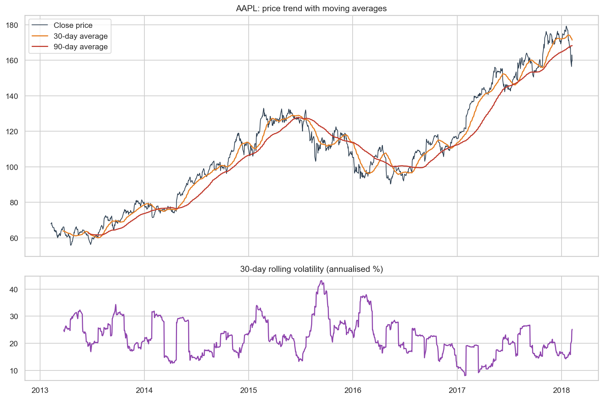
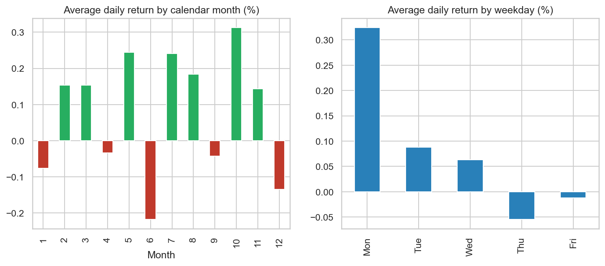
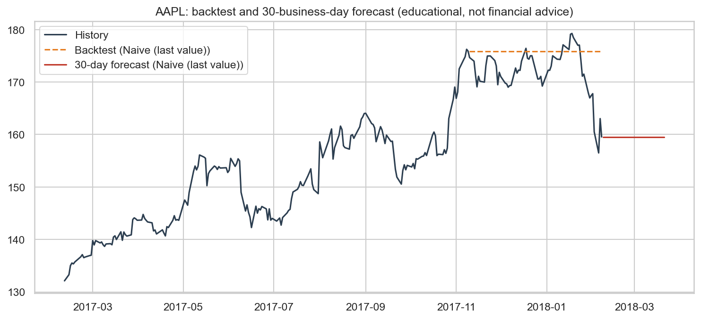
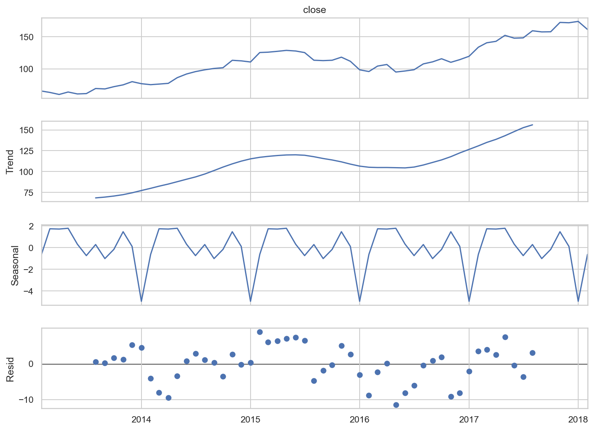

<p align="center"></p>
<p align="center"><a href="https://github.com/khnbutt118-dev">← PROFILE</a> &nbsp;·&nbsp; <a href="https://hassanbuttportfolio.vercel.app/">PORTFOLIO</a> &nbsp;·&nbsp; <a href="https://www.linkedin.com/in/hassan-butt-ab0036334/">LINKEDIN</a></p>

<p align="center"></p>

# 📈 AAPL · Time-Series Exploration & Forecasting
**Trend, volatility, calendar patterns and a simple out-of-sample forecast comparison.**

<table><tr><td align="center"><h2>1,259</h2><sub>Observations</sub></td><td align="center"><h2>18.7%</h2><sub>Reported CAGR</sub></td><td align="center"><h2>2.7%</h2><sub>Backtest MAPE</sub></td><td align="center"><h2>60</h2><sub>Test trading days</sub></td></tr></table>

## 📉 Visual analysis
<p align="center"></p>
<p align="center"></p>
<p align="center"></p>
<p align="center"></p>

## 🧠 What the experiment found
| Analysis | Result |
|:--|:--|
| Price range in the supplied series | 67.85 → 159.54 over 5 years |
| Best tested forecast baseline | **Naive (last value)** |
| Backtest MAPE | **2.7%** on the last 60 trading days |
| Annualised rolling volatility | About **22%** (range 8%–43%) |
| Calendar pattern | Month 10 highest and month 6 lowest average daily return; weak evidence with ~5 years |

## 🔬 Workflow
30/90-day moving averages → Rolling volatility → Calendar patterns → Seasonal decomposition → 60-day backtest → 30-business-day illustrative forecast

## ▶️ Reproduce
```bash
pip install -r requirements.txt
python main.py
```

<details><summary><b>Dataset & evaluation notes</b></summary>

- Dataset: [S&P 500 daily stock prices](https://www.kaggle.com/datasets/camnugent/sandp500)
- Series analysed: AAPL · 1,259 observations
- Model comparison: naive, linear trend, Holt-Winters
- Output: `forecast_model_comparison.csv`

</details>

> Forecasts are educational demonstrations, not investment advice. A low backtest error on a short holdout does not guarantee future performance.
<p align="center"><sub>Python · Pandas · Time-series analysis · Forecast evaluation</sub></p>
