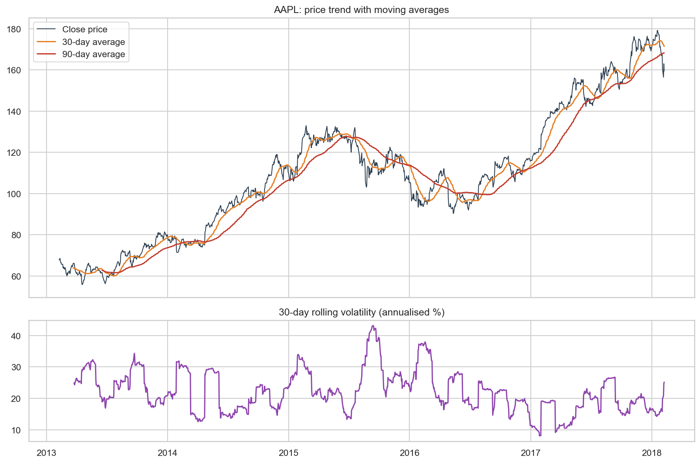
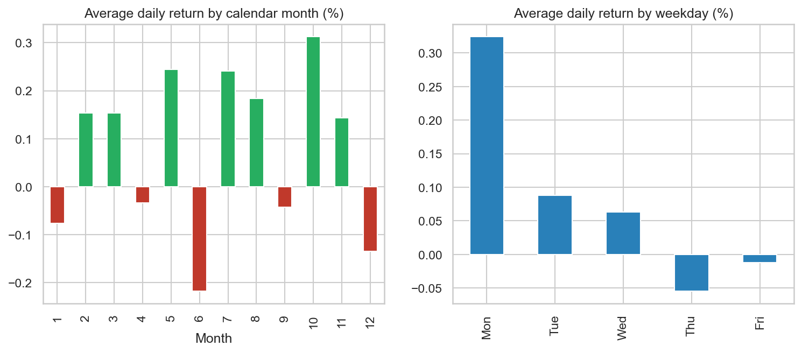
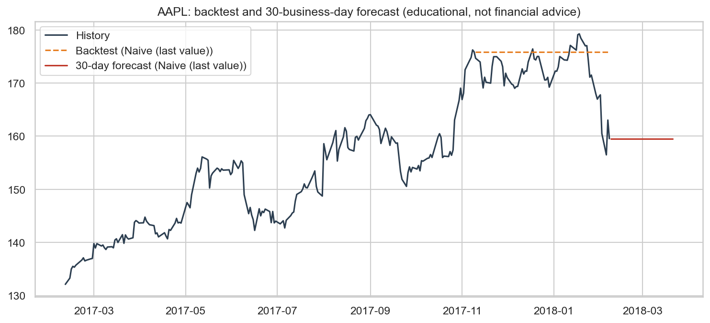
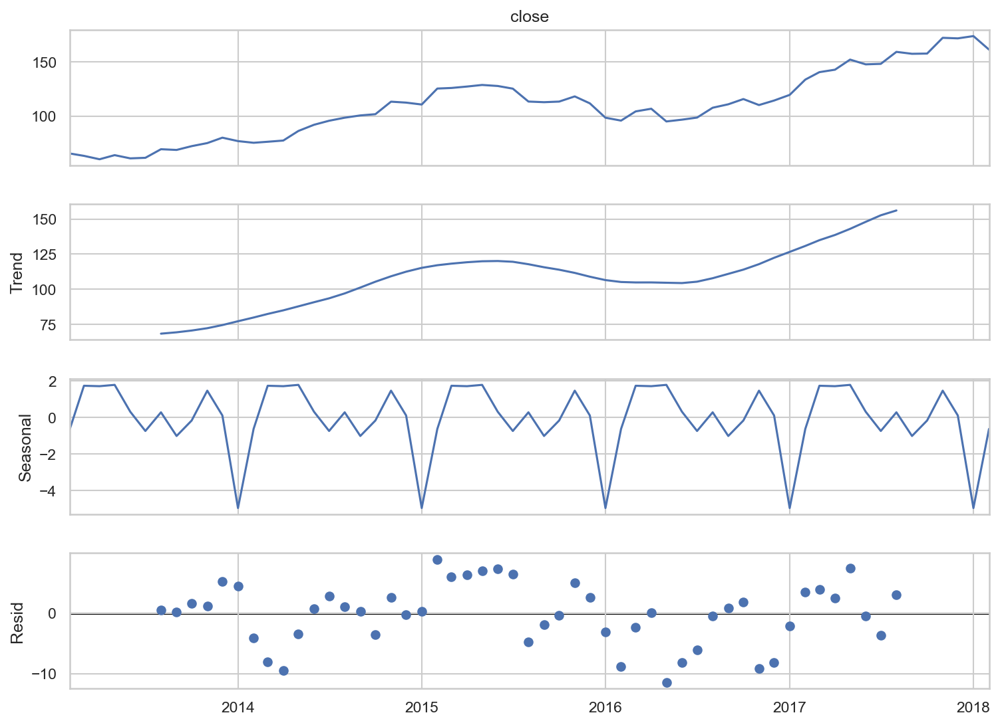

# Time Series Analysis (Stock Prices)

> Synent Technologies Data Science Internship | Task 7 (Intermediate level) | Author: Hassan Butt

## Problem statement
Analyse time-based trends and seasonality in stock prices and test simple forecasts honestly.

## Dataset details
- **Dataset:** S&P 500 daily stock prices (5 years)
- **Source:** https://www.kaggle.com/datasets/camnugent/sandp500
- **Size used:** 1,259 rows x 1 columns

## Approach
1. Trend analysis with 30/90-day moving averages and rolling volatility
2. Seasonality: monthly and weekday return patterns, seasonal decomposition
3. Backtested three forecasting models on the last 60 trading days (naive, linear trend, Holt-Winters)
4. 30-business-day forecast with the best model (educational, not financial advice)

## Results
| Metric | Value |
|---|---|
| Ticker | AAPL |
| Observations | 1259 |
| CAGR | 18.7% |
| Best forecast model | Naive (last value) |
| Backtest MAPE | 2.7% |

**Key insights**

- AAPL moved from 67.85 to 159.54 over 5.0 years (CAGR about 18.7% per year).
- Average annualised volatility (30-day rolling) was about 22%, ranging from 8% to 43%.
- Calendar month 10 had the highest and month 6 the lowest average daily return, but with only about 5 years of data this seasonality is weak evidence.
- In the backtest on the last 60 trading days the best model was 'Naive (last value)' (MAPE 2.7%); forecasts of prices are uncertain and are shown for learning only.

**Figures**






**Other output files:** `forecast_model_comparison.csv`

## How to run
```bash
pip install -r requirements.txt
python main.py
```

> Forecasts are for learning only and are not financial advice.

## Project structure
```
main.py            # full analysis / pipeline
requirements.txt
data/              # dataset (see data/README.md)
outputs/           # figures, tables and reports
```

## Academic integrity
All analysis code and write-ups in this repository were written by the author. The dataset belongs to its original creators (see link above).
